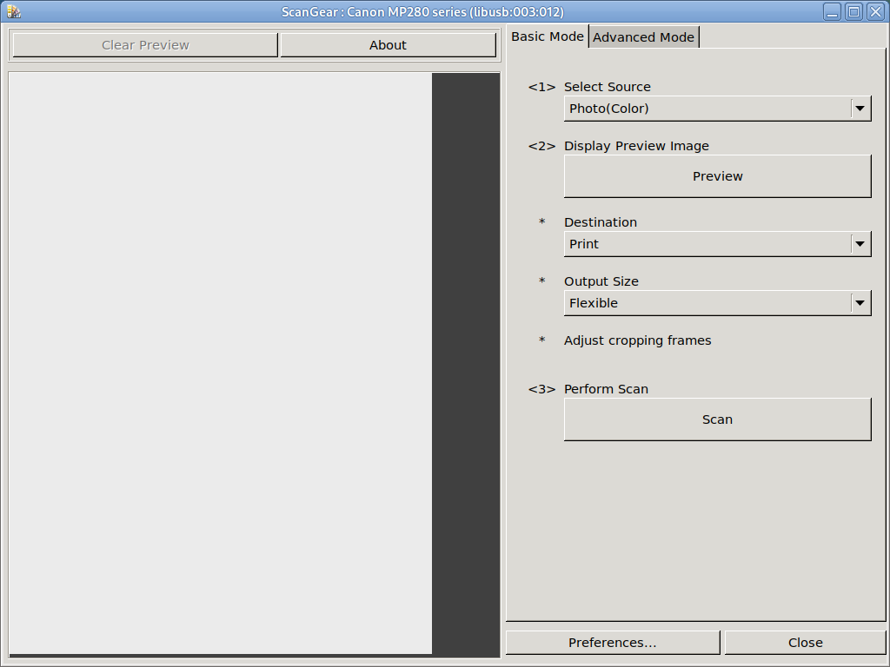
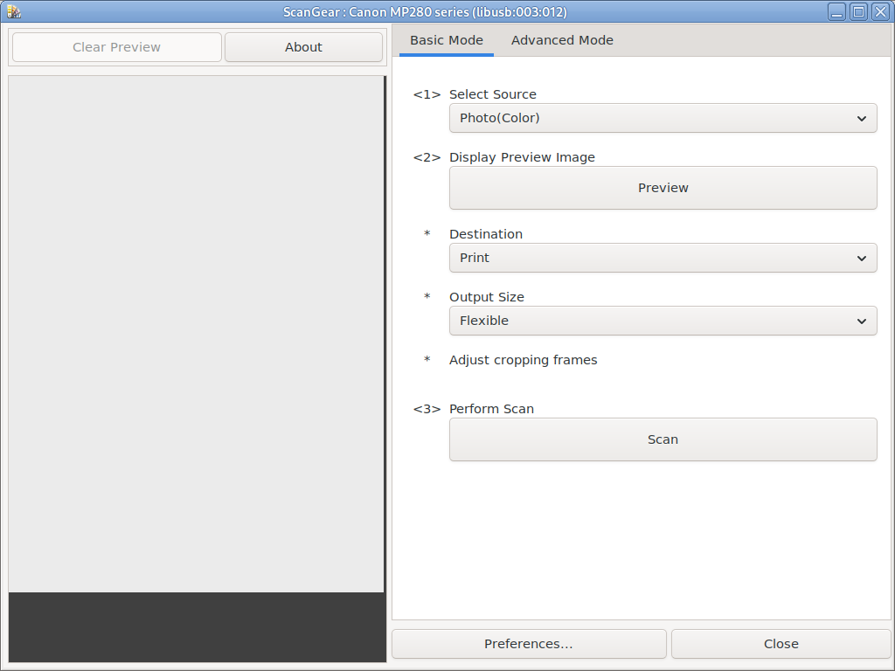
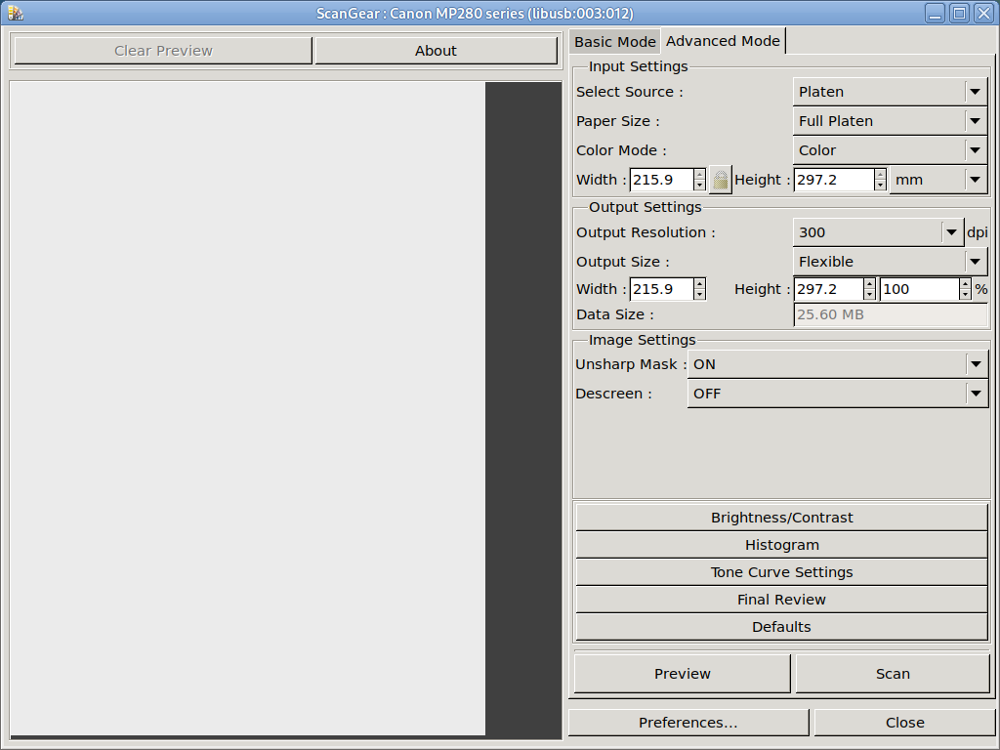
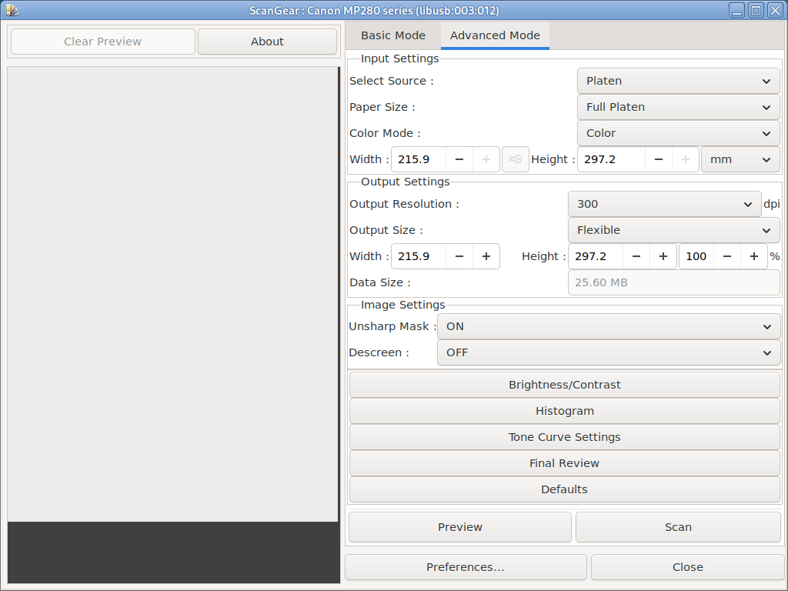
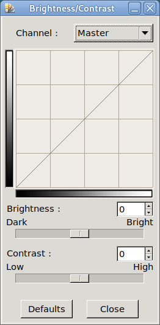
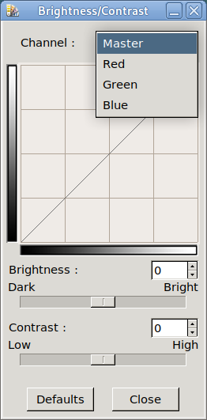
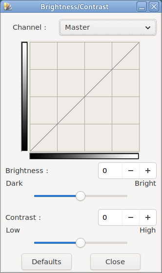
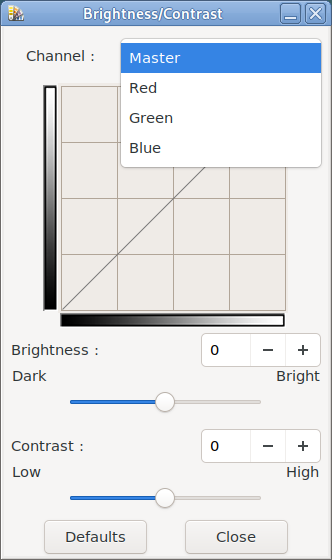

# GTK3 Migration

## Context and reasons for GTK3 migration

From https://lwn.net/Articles/1051006/: Debian discusses removing GTK 2 for Forky

> GTK 2 was [released](https://mail.gnome.org/archives/gtk-devel-list/2002-March/msg00161.html)
> in 2002 and was declared end of life with the [release of GTK 4](https://blog.gtk.org/2020/12/16/gtk-4-0/)
> on December 16, 2020; the final release, [2.24.33](https://download.gnome.org/sources/gtk+/2.24/gtk%2B-2.24.33.news),
> was published a few days later. The GTK project currently maintains two
> stable branches—GTK 3.x ("oldstable") and GTK 4.x ("stable").
> The GTK 3.x branch will be maintained until the project releases GTK 5,
> and the project has not yet announced any firm plans for such a release.
>
> On [January 7, 2026](https://lwn.net/ml/all/t8i3cd.3w38qy9ijg77x@riseup.net/)
> Matthias Geiger announced that Debian's GNOME team has a goal of removing
> GTK 2 from Forky before it is released in 2027.

This sparked the creation of the [GTK2-NG](https://git.devuan.org/Daemonratte/gtk2-ng)
project: an unofficial community-maintained fork of historical GTK2,
not affiliated with GTK or GNOME, with the aim of keeping GTK2 alive
and usable on modern 64-bit Linux systems.

## ScanGear MP migration

Since the long term success of GTK2-NG project isn't known at this time,
as well as the actual GTK2 removal from Forky, a GTK3 migration has been done
for this version of the ScanGear MP project in order to have the possibility
to use it as long as GTK3 is available in Debian.

The migration impacted only on the front-end part of the project,
leaving the back-end untouched. It has been tested with a real scanner
(Canon PIXMA MP280) to verify the most used parameters (DPI, area,
Color / Grayscale / Black and White) were working as expected.

### Basic Mode GTK2 and GTK3

### Advanced Mode GTK2 and GTK3

### Brightness modal GTK2 and GTK3

  

